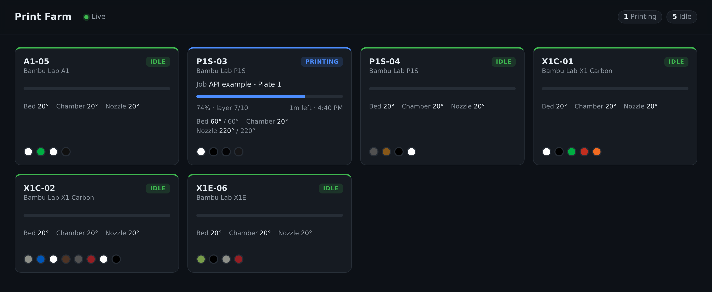

# Live printer dashboard

Walking the farm to see which printers are done, which are stuck and which need
filament gets slower with every printer you add. This puts the whole farm on one
screen, so a TV on the wall answers "what needs me next?" at a glance.



Each card shows the printer's state, the job it is printing, progress, layer, time
left and the clock time it will finish, nozzle, bed and chamber temperatures, any
errors the printer reports, and the filament loaded in each slot. Everything updates
the moment the printer reports it.

## Run it

```bash
cp .env.example .env     # add your API key and store ID
npm install
npm start                # http://127.0.0.1:3700
```

To show it on a TV or another computer, set `HOST=0.0.0.0` in `.env`. Anyone who can
reach the page sees your whole farm, so keep it on your own network.

**API key permissions:** `printer.view`, `printer.stats`.

## How it works

```
Printago MQTT ──printer-stats/#──► server.ts ──Server-Sent Events──► public/index.html
Printago REST ──GET /v1/printers─┘
```

- `GET /v1/printers` gives names and models. They rarely change, so the server
  reloads them every five minutes, or sooner when a printer it has never seen starts
  reporting.
- MQTT topic `stores/{storeId}/printer-stats/#` streams live stats. Messages are
  retained, so every printer's current state arrives as soon as the server
  subscribes. An empty message means the printer was removed.
- The server keeps the latest stat per printer and forwards it to every open browser
  over Server-Sent Events. One MQTT connection serves any number of screens, and the
  API key stays on the server.

The printer's `state` is what the printer itself reports (`IDLE`, `PREPARE`,
`RUNNING`, `PAUSE`, `FINISH`, `FAILED`). The page folds these into the statuses a
person cares about. A stat whose `expiresAt` has passed is shown as offline: the
printer stopped reporting.

## Make it yours

- **Sort by urgency.** Put `Error`, `Failed` and `Finished` cards first so the
  printers that need a person float to the top. See `render()` in `public/index.html`.
- **Show the next job.** Add the head of the queue from
  `GET /v1/print-jobs?status=pending&hidden=false&sort=priority:asc,queueOrder:asc&limit=5`.
- **Add camera stills.** See [camera-snapshot-archiver](../camera-snapshot-archiver)
  for signing snapshot URLs without spending your rate limit.
