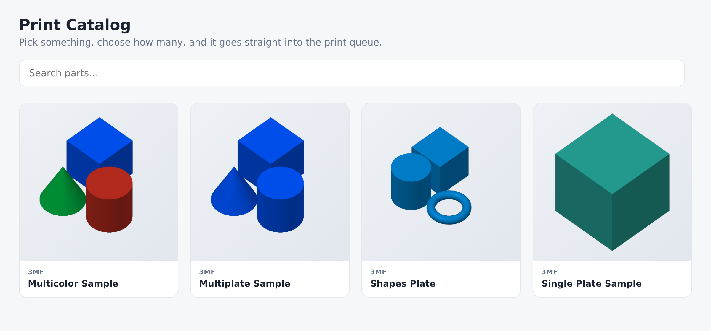
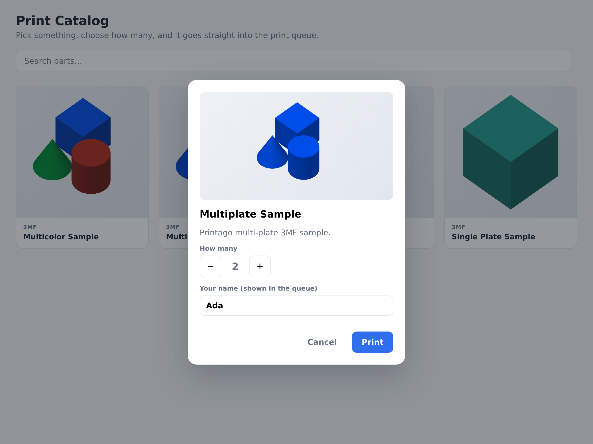

# Parts catalog kiosk

In a makerspace, a classroom or on a shop floor, the people who need a part printed
usually cannot, or should not, log in to the print farm. So they ask someone who
can, and that person becomes the queue. This is a catalog they can browse on a
tablet: find the part, choose how many, press Print, and it goes into the Printago
queue with their name on it.





## Run it

```bash
cp .env.example .env     # add your API key
npm install
npm start                # http://127.0.0.1:3701
```

| Setting | |
|---|---|
| `CATALOG_TAG=kiosk` | Only show parts carrying this tag. Tag the parts you want on the kiosk in Printago and leave the rest off. Empty shows every part. |
| `KIOSK_PIN=4821` | Ask for a PIN before printing. |
| `MAX_QUANTITY=10` | Most copies per request. |
| `HOST=0.0.0.0` | Reach it from a tablet on your network. |

Parts that have not finished processing are left out, because they cannot be printed
yet. Parts in folders get a filter chip per folder.

**API key permissions:** `part.view`, `file.download`, `build.create`, `queue.view`.
Nothing that can delete or change parts, so a lost tablet cannot damage your library.

## How it works

The Node server holds the API key. The browser only talks to the server.

| Kiosk route | Printago API |
|---|---|
| `GET /api/catalog` | `GET /v1/parts` (paged with `limit`, `offset`, `meta=true`), `GET /v1/folders/parts`, `POST /v1/storage/signed-urls` for thumbnails |
| `POST /api/print` | `POST /v2/builds` with the part, quantity and a label like `Bracket · Ada` |
| `GET /api/builds/:id` | `GET /v1/print-jobs?partBuildId=...`, cached 15 seconds |

**Thumbnails.** A part's `thumbnailUri` is usually a storage path. Browsers need a
signed URL, so the server signs them in batches of 100 with
`POST /v1/storage/signed-urls` and asks for one hour (`"duration": 3600`); the
default is five minutes. Some parts already carry a full URL, and a part whose
thumbnail is still being made has a placeholder, so the server handles all three.

**Rate limits.** The catalog is cached for five minutes, and job status for 15
seconds per build, so ten tablets cost the same as one.

## Make it yours

- **Ask for options.** For parts with parameters (OpenSCAD, CadQuery, 3MF text),
  add inputs to the dialog and send them as `parameters` in the build.
- **Route by room.** Add `tags: {"user.tags": "Lab 2"}` to the build so only printers
  tagged `Lab 2` pick up kiosk jobs.
- **Sign people in.** Swap the PIN for your school or company login and put the
  person's name in the label from their account.
